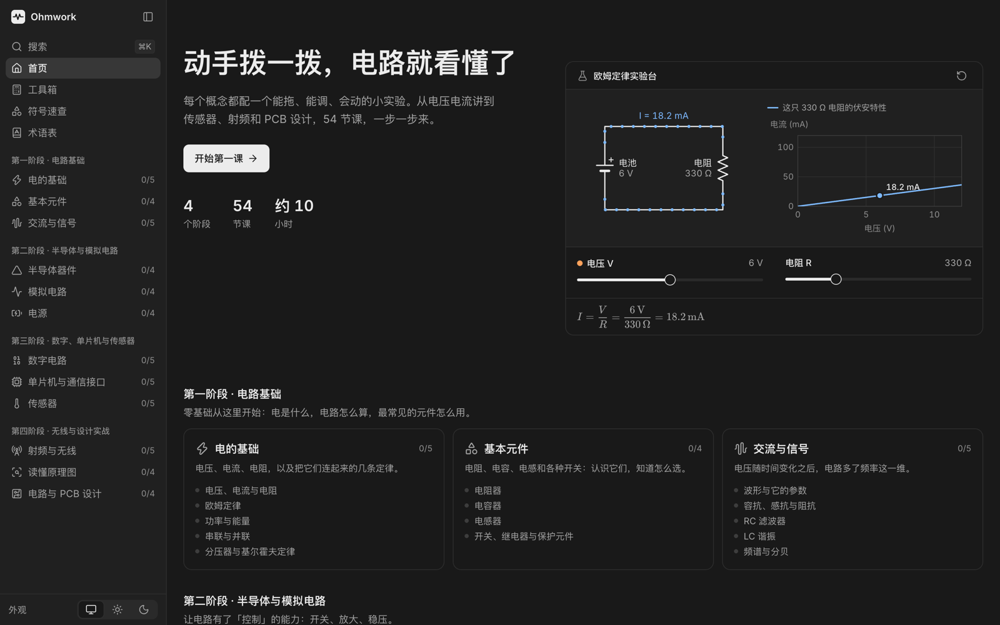
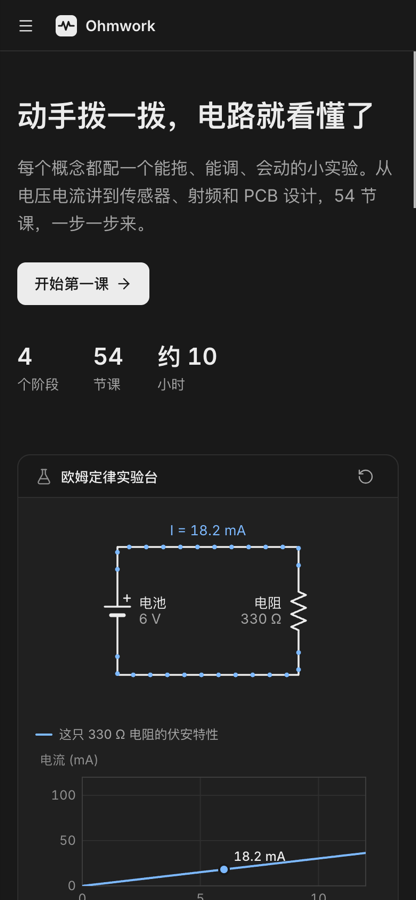

# Ohmwork

交互式电子电路学堂：每个概念配一个能拖、能调、会动的小实验。从电压电流讲到传感器、射频和 PCB 设计，零基础可以按顺序学，有经验的人可以按章节回来温习。



**在线体验：<https://ohmwork.linjiejim.com>** · [课程内容](#内容) · [自己加一节课](#加一节课)

## 为什么做这个

学电路的时候，通常只有两种材料：

- **教材**：图是静态的。「电压像水压，电流像水流」——读起来都对，但脑子里没有画面，也说不清改一个量另外两个会怎么动。
- **仿真软件**：能算得很准，但先要会搭网表、选模型、看波形，门槛落在「学电路」之前。

中间那块地方是空的：**想拨一下、马上看到反应，但不想先成为工程师。**

Ohmwork 就是填这块的。每个概念配一个能动手的模型：拖电压滑块，电流数值、欧姆定律算式和伏安曲线一起变；讲 RC 滤波给一条能改频率的曲线；讲时序给能对拍的波形图。电路图都是自己画的 SVG，公式用 KaTeX 排，不嵌图片，缩放都清楚。

## 每节课长什么样

- **能拖的仿真**：滑块、开关、波形，改一个参数全页联动，不是截图也不是嵌视频。
- **一分多钟的配音动画讲解**：每节课开头一段，配文字稿，也可以只看文字。
- **算出来的，不是编的**：数值由组件里的公式实时计算，图上标的就是算出来的值。
- **一节十分钟**：难度（入门 / 进阶）和预估时长标在目录里，按章节顺序学或跳着查都行。

手机端同样能拖：



## 运行

```bash
npm install
npm run dev        # http://localhost:5273
```

需要本地联调账号登录与云端同步时，另开一个终端启动本地 Worker（Node 22 内置 SQLite 直接运行，自动执行 `worker/migrations/` 建表，数据存在 `.worker.sqlite`）：

```bash
MOCK_GITHUB=1 npm run dev:worker   # http://127.0.0.1:8787，Vite 自动代理 /api
```

```bash
npm run build      # 类型检查 + 打包到 dist/
npm test           # 课程冒烟测试 + 设计守卫 + 同步后端测试
```

版面检查（文字重叠、出界、横向溢出）在浏览器里跑：开着开发服务器，在控制台执行
`(await import("/scripts/audit-layout.js")).audit()`，桌面和手机宽度各跑一次。

### PR 里的截图和录屏

```bash
node scripts/pr-assets.mjs 5 login.png account.png   # 5 是 PR 号；还没开 PR 就写 draft
```

脚本把文件提交到本仓库的 `refs/pr-assets/pr-5`，在标准输出打印一段 markdown，直接贴进 PR 描述：竖图 240 宽每行三张，横图 460 宽每行两张，文件名当图注。链接钉在提交 SHA 上，之后再传也不会失效。

- 这个 ref 不在 `refs/heads` 下，`git clone`、`git fetch` 默认都不拉，仓库不会因为截图变大（`git clone --mirror` 会拉）。工作区和暂存区不受影响。
- 支持 png / jpg / webp / gif / mp4 / mov，单个文件不超过 50 MB。视频会用 ffmpeg 转成 GIF 内嵌（`brew install ffmpeg`），另附原片链接；没装 ffmpeg 就只有链接。
- **传上去就永久公开**：任何人拿到链接都能打开，旧的 ref 不清理，删掉也不保证马上打不开。截图里不能有真实用户的数据、密钥、token、本机路径。
- 要有本仓库的推送权限。从 fork 提 PR 的外部贡献者用不了，照旧把图拖进 GitHub 网页的输入框就行。
- Claude 云端会话只能推 `refs/heads/*`：脚本被拒后会自动改推临时分支 `pr-assets-inbox/<PR号>-<随机>`，[PR assets inbox](.github/workflows/pr-assets-inbox.yml) 工作流把素材搬进 `refs/pr-assets/pr-<PR号>`，再删掉这个分支。打印出的链接推上去就能用，搬完以后也一直能用。
- 想看一个 PR 传过哪些文件：`git fetch origin refs/pr-assets/pr-5 && git ls-tree -r --name-only FETCH_HEAD`。

## 部署

线上地址 https://ohmwork.linjiejim.com ，托管在 GitHub Pages。推送到 `main` 后，`.github/workflows/deploy.yml` 会先跑测试、打包，再发布；拉取请求只跑检查，不发布。

- **域名**：在仓库的 Pages 设置里绑定。DNS 在腾讯云 DNSPod，记录为 `CNAME ohmwork → linjiejim.github.io.`
- **页面路由**：用的是路径式路由。打包时给每个页面（课程、章节、工具、速查）各写一份 HTML，带它自己的标题、描述和分享卡片，深层链接直接返回 200；另写 `404.html`（不进搜索）兜住其余地址，和 `sitemap.xml`。页面清单和文案在 `src/site/seo.ts`，加课不用另外登记。
- **分享图**：`public/og.png`（1200 × 630）和 `public/apple-touch-icon.png` 由 `scripts/og-image.mjs` 生成，改了首页或品牌标记后开着开发服务器重跑一次。
- **可选的账号与云端进度同步（Cloudflare Worker + D1）**：后端在 `worker/`，部署在 Jim 个人 Cloudflare 账号，API 域名 `ohmwork-api.jimlin.me`。没配 `VITE_API_BASE` 时站点保持纯本地模式，不显示登录入口。不用 `*.workers.dev`：它在中国大陆基本打不开；`linjiejim.com` 的 DNS 在 DNSPod，Worker 也挂不上去，所以用 Cloudflare 上的 `jimlin.me`。要开启时（命令都在 `worker/` 下跑，步骤也写在 `worker/wrangler.toml` 开头）：
  1. 登录个人账号。本机 wrangler 默认登录的是另一个账号，别切换它，给个人账号建一个命名登录并绑到仓库目录（wrangler 4.169 起支持，仍是实验功能）：`npx wrangler auth create personal`，再 `npx wrangler auth activate personal <仓库根目录>`；之后在仓库里（含 `.claude/worktrees/` 下的工作树）跑 wrangler 都用这个账号，`npx wrangler whoami` 可核对。不想用实验功能时，改用只授权个人账户的 API token（Workers Scripts、D1、Workers Routes 编辑，jimlin.me 的 Zone 读取），写进 `worker/.env` 的 `CLOUDFLARE_API_TOKEN`（已忽略，不进 git，wrangler 会自动读）。
  2. 创建 D1 数据库并把 `database_id` 填进 `worker/wrangler.toml`：`npm install && npx wrangler d1 create ohmwork`。
  3. 执行建表迁移：`npx wrangler d1 migrations apply ohmwork --remote`。
  4. 如需开启 GitHub OAuth，在 GitHub 创建一个 OAuth App（回调地址填 `https://ohmwork-api.jimlin.me/auth/github/callback`），再写入密钥：`npx wrangler secret put GITHUB_CLIENT_ID` 和 `npx wrangler secret put GITHUB_CLIENT_SECRET`（不配时仍可用用户名和密码登录）。
  5. 部署 Worker：`npx wrangler deploy`，首次部署会自动在 `jimlin.me` 下建好 `ohmwork-api` 的记录和证书。
  6. 在 GitHub 仓库的 **Settings → Variables → Actions** 新增 `VITE_API_BASE` = `https://ohmwork-api.jimlin.me`，重新触发一次 Pages 部署即可。

## 内容

四个阶段、12 章、54 节课，目录在 `src/curriculum/curriculum.ts`：

1. **电路基础**：电的基础、基本元件、交流与信号
2. **半导体与模拟电路**：半导体器件、模拟电路、电源
3. **数字、单片机与传感器**：数字电路、单片机与通信接口、传感器
4. **无线与设计实战**：射频与无线、读懂原理图、电路与 PCB 设计

另有三个随手查的页面：工具箱（常用计算器）、符号速查、术语表。⌘K 搜索全站。学习进度默认存在浏览器本地，也可以可选登录（GitHub OAuth 或用户名密码，支持互相绑定）同步到云端。

## 结构

```
src/
  auth/          可选账号登录、绑定与进度同步客户端
  curriculum/    课程目录和学习进度
  content/       课程正文，<章>/<课>.mdx
  widgets/       各章的交互组件，<章>/<组件>.tsx
  lab/           交互工具包：Lab 外框、Plot 曲线图、Timing 时序图、Schematic 电路图与元件符号
  mdx/           课程里能直接用的组件（Note、Tip、Warn、Figure、Quiz）
  site/          站点外壳和页面（首页、章节页、课程页、工具箱、符号速查、术语表）
  components/ui/ jim-uiux 设计系统组件
  tests/         课程冒烟测试、设计守卫、账号与同步测试
worker/          可选的 Cloudflare Worker + D1 云同步后端（含 migrations/ 建表脚本）
docs/
  AUTHORING.md   怎么写一节课、怎么写交互组件
  DESIGN.md      设计系统的用法和例外
```

## 加一节课

1. 在 `src/curriculum/curriculum.ts` 里登记标题、摘要、难度和时长。
2. 写 `src/content/<章>/<课>.mdx`，交互组件放 `src/widgets/<章>/`。
3. 照 `docs/AUTHORING.md` 的规范写，跑 `npm test`。

技术栈：Vite、React 19、TypeScript、Tailwind CSS v4、MDX、KaTeX、jim-uiux。

## 许可

[MIT](LICENSE)。课程文字与插图同样按 MIT 授权，欢迎转载和改写，注明来源即可。
